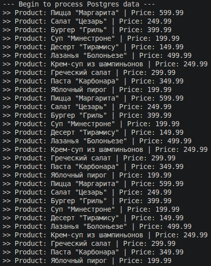

# bootcamp_darkstore_provider

Учебный back-end проект "АС Поставщиков"

Java 21, Spring Boot, Hibernate, Maven

## Анализ проекта

### ReactiveGoodService.java

Этот класс является ядром реактивной обработки. Он использует существующий GoodRepository для извлечения данных из базы данных PostgreSQL. Главная особенность - оборачивание блокирующего вызова базы данных findAll() в реактивный поток с помощью Flowable.fromCallable(). Далее данные обрабатываются как поток событий: flatMapIterable() разбивает список на отдельные объекты, filter() отсеивает ненужные записи, а map() трансформирует их в строки. Переключение на Schedulers.io() для базы данных и Schedulers.computation() для обработки гарантирует, что основной поток (Main Thread) не будет заблокирован.

### ReactiveDataRunner.java

Этот класс реализует интерфейс CommandLineRunner от Spring Boot. Его задача - автоматически запустить реактивный конвейер сразу после старта приложения, без необходимости делать HTTP-запросы. Вызов Thread.sleep(3000) в конце метода run() добавлен намеренно: он удерживает приложение от немедленного завершения, давая асинхронным потокам RxJava время для полной обработки базы данных и вывода результатов в консоль.

## Инструкция

Компиляция: `mvn clean compile`
Запуск: `mvn spring-boot:run`

## Результат запуска

